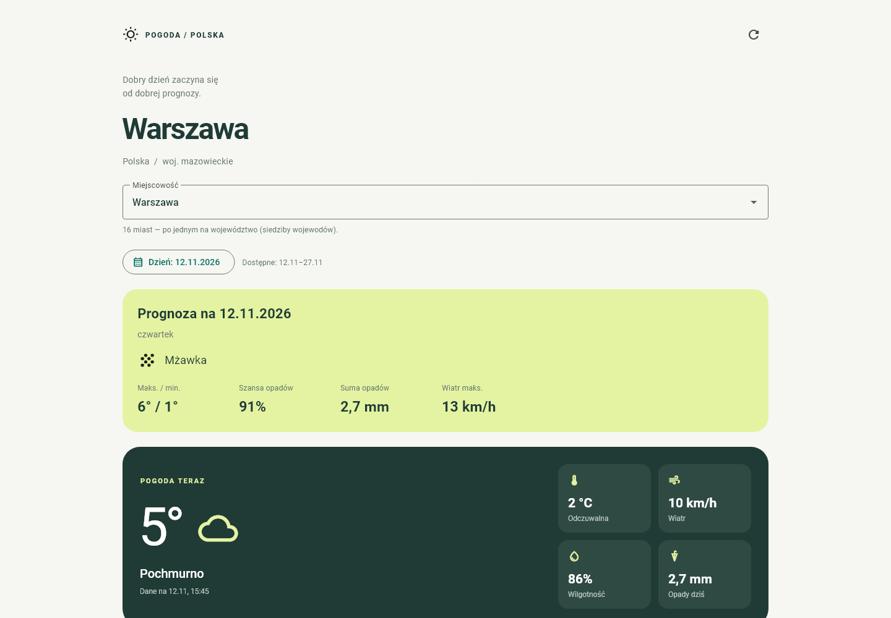
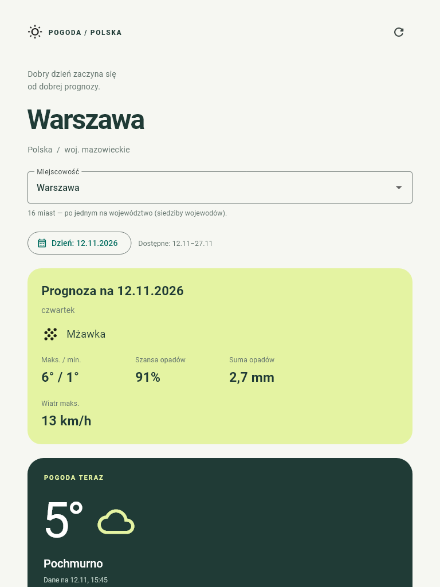
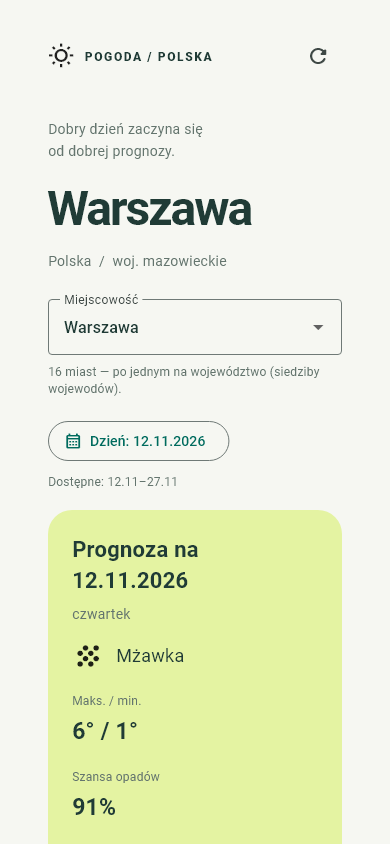

# MeteoSzybkaPogoda

Prosta aplikacja **Dart + Flutter Web**, po polsku, z bieżącą pogodą i prognozą na 16 dni. Układ dopasowuje się do komputera i telefonu.

[Uruchom aplikację](https://warszawa-pogoda-radek.obszar-roboc-5333.chatgpt.site/)

## Zrzuty ekranu

### Komputer — 1440 px



### Tablet — 768 px



### Telefon — 390 px



## Uruchomienie

Wymagany Flutter w kanale stable (Dart >= 3.8). Z katalogu repozytorium:

```powershell
flutter pub get
flutter run -d chrome
```

## Funkcje

- Aktualna temperatura, temperatura odczuwalna, wilgotność i wiatr.
- Prognoza na 16 dni: temperatury maksymalna i minimalna, opis pogody, najwyższe dzienne prawdopodobieństwo opadów i maksymalny wiatr.
- Dzisiejsza prognozowana suma opadów (cały dzień, nie pomiar bieżący).
- Ręczne odświeżanie, wskaźnik pobierania i ponowienie po błędzie.
- Zachowanie ostatnio pobranych danych podczas nieudanego odświeżania z ostrzeżeniem, że mogą być nieaktualne. Dane nie są zapisywane pomiędzy uruchomieniami.
- Obsługa brakujących pomiarów symbolem „—”.
- Wybór jednego z 16 miast wojewódzkich, bez pytania o dostęp do lokalizacji użytkownika.
- Wybór dnia z kalendarza w zakresie prognozy zwróconej przez API.

## Źródło danych

[Open-Meteo](https://open-meteo.com/) to projekt [open source](https://github.com/open-meteo/open-meteo). Publiczny endpoint nie wymaga klucza i jest bezpłatny **do użytku niekomercyjnego**, zgodnie z [warunkami](https://open-meteo.com/en/terms). Dane są udostępniane na licencji [CC BY 4.0](https://creativecommons.org/licenses/by/4.0/); aplikacja zawiera podpis źródła. Komercyjne użycie hostowanego API wymaga odpowiedniego planu. Limity bezpłatnego API: poniżej 10 000 zapytań/dzień, 5 000/godzinę i 600/minutę.

Endpoint: `https://api.open-meteo.com/v1/forecast`. Domyślne współrzędne Warszawy: `52.2297, 21.0122`; współrzędne wszystkich miast są w `lib/cities.dart`. Parametry zapytania są w `lib/weather.dart`. [Dokumentacja](https://open-meteo.com/en/docs).

Czas pochodzi z API i jest czasem lokalnym Warszawy (`Europe/Warsaw`), niezależnie od strefy urządzenia. Temperatura: °C, wiatr: km/h, opady: mm. „Dane na” wskazuje czas danych bieżących, nie czas wykonania zapytania. Bieżące wartości Open-Meteo są danymi modelowymi. Aplikacja pobiera dane przy otwarciu, zmianie miasta i po kliknięciu odświeżania; nie odpytuje API w tle. Wymaga połączenia z internetem, bez backendu i konta.

## Weryfikacja i kompilacja

```powershell
flutter analyze
flutter test
flutter build web --release
```

Wynik produkcyjny jest w `build/web`. Udostępnij zawartość przez serwer HTTP/HTTPS; otwieranie samego pliku `index.html` z dysku nie uruchomi aplikacji poprawnie. Publikowanie w podkatalogu wymaga `flutter build web --base-href /nazwa/`.

Testy sprawdzają odczyt danych, błędy API i sieci, brakujące pomiary, kody pogody, ponawianie, zachowanie danych przy awarii odświeżania, blokowanie jednoczesnych zapytań oraz układ przy szerokościach 320, 390, 768 i 1440 px. Testy używają danych przykładowych i nie odpytują API.

## Struktura

- `lib/main.dart` — interfejs i stan ekranu.
- `lib/weather.dart` — modele, komunikacja z API, opisy kodów WMO.
- `test/` — testy logiki i interfejsu.
- `web/index.html` — strona startowa Flutter Web.

Projekt zawiera platformę web. Dodanie Androida wymaga wygenerowania plików platformy (`flutter create --platforms=android .`), zainstalowania Android SDK i dodania uprawnienia `android.permission.INTERNET` w głównym manifeście aplikacji.


## Miasta i kalendarz

Publiczna aplikacja: [warszawa-pogoda-radek.obszar-roboc-5333.chatgpt.site](https://warszawa-pogoda-radek.obszar-roboc-5333.chatgpt.site/)

Lista zawiera po jednej siedzibie wojewody dla każdego z 16 województw: Białystok, Bydgoszcz, Gdańsk, Gorzów Wielkopolski, Katowice, Kielce, Kraków, Lublin, Łódź, Olsztyn, Opole, Poznań, Rzeszów, Szczecin, Warszawa i Wrocław. Dla kujawsko-pomorskiego wybrano Bydgoszcz, a dla lubuskiego Gorzów Wielkopolski. Drugimi stolicami tych województw są odpowiednio Toruń i Zielona Góra. Zobacz [urzędową listę](https://www.gov.pl/web/mswia/urzedy-wojewodzkie).

Kalendarz obejmuje dni faktycznie zwrócone przez API (maksymalnie 16 dni od dzisiaj). Nie udostępnia danych historycznych ani prognoz poza tym zakresem. Wybrany dzień pokazuje osobno temperaturę maksymalną i minimalną, szansę opadów, sumę opadów i maksymalny wiatr. Można też wybrać dzień klikając kartę prognozy. Bieżąca pogoda jest wyświetlana tylko przy wyborze dzisiaj. Zmiana dnia nie generuje nowego zapytania do API. Brakujące wartości są oznaczone „—”.

Data pozostaje wybrana po zmianie miasta lub odświeżeniu, o ile jest nadal dostępna. W innym przypadku aplikacja wybiera pierwszy dostępny dzień. Po zmianie miasta stare dane są usuwane, a opóźnione odpowiedzi dla poprzednich miast są pomijane.

Testy obejmują wybór i anulowanie daty, zakres kalendarza, współrzędne wszystkich miast, długą nazwę miejscowości na ekranie 320 px oraz odpowiedzi sieciowe w odwrotnej kolejności.
